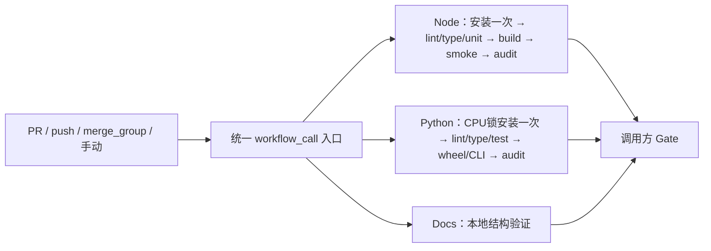
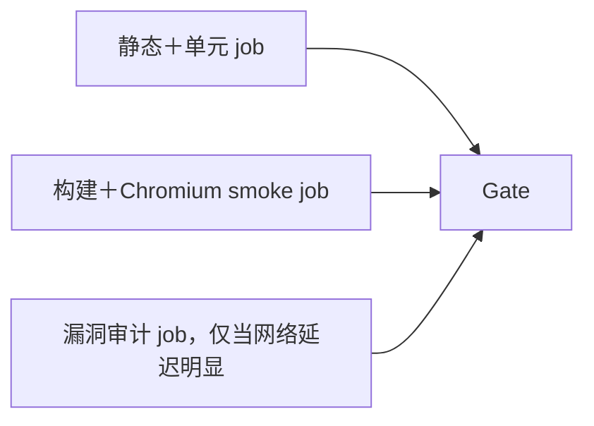

# 通用 CI 设计（可公开部分）

核对日期：2026-10-13 UTC。目标仓库：[`ThaneJoss/github-ci`](https://github.com/ThaneJoss/github-ci)。本仓库包含可复用模块与调用示例，实际发布和执行范围见[验证记录](VALIDATION.zh-CN.md)。它统一质量契约、门禁和安全边界；项目仍拥有真实检查脚本。不能用统一脚本名证明存在相应测试覆盖。

本流程禁止按repository、owner/repo名单或项目特殊case分流；调用方仅提供技术栈/能力inputs与真实检查命令。内部项目对照不参与运行时。具体约束见[可移植性契约](PORTABILITY.zh-CN.md)，外部一手实践见[大型项目研究](INDUSTRY-PRACTICES.zh-CN.md)。

## 1. 三种配置档和最低契约

| 配置档 | PR 最小验证 | 按实际能力启用 | 不默认加入 |
|---|---|---|---|
| Node / Web / Worker | 锁文件安装、lint、实际类型检查（适用时）、单元和错误路径、构建、依赖漏洞门禁 | Vue SFC、Worker 本地请求与环境绑定 mock、构建产物检查、Chromium 关键路径及 axe、Node CLI/npm pack | 全浏览器×全系统×全Node版本、真实云部署 |
| Python CPU | 可重建 CPU CI 依赖、静态检查、快速单元/合成输入、无大数据的 import/CLI 或 wheel 验证、依赖漏洞门禁 | 形状/梯度/CPU小前向、配置加载、包入口、跨Python兼容 | GPU训练、模型下载、完整数据集、全实验复现 |
| 插件 / 资料库 | 与文件有关的语法、JSON/YAML/schema、manifest、内部链接或vault结构验证 | 有构建的插件启用Node档、插件API mock、打包检查 | 为README/txt仓库安装Node/Python依赖或假造空测试 |

零依赖插件通过docs档的可选`lightweight-node-version`固定Node，运行原生测试及打包；纯资料档不安装Node。

项目没有类型系统、构建或运行时依赖时，应明确写“不适用”并选轻档；不要用 `echo OK` 伪装测试。未实现的重要测试应补齐真实断言，不能把门禁配置成功当作覆盖完成。脚本空字符串仅表示调用方明确不采用该可选能力，不提供质量证明。

## 2. 实现与 DAG

`ci.yml` 是 `workflow_call` 入口，通过 `profile` 选择 `node.yml`、`python.yml` 或 `docs.yml`。嵌套工作流以 `./.github/workflows/...` 取模板同一提交。每个模块只运行一个 Quality job；未选模块按设计 skip。非法 profile 有独立失败路径。成功模块最后一步输出 `quality-passed=true`，只有全部启用检查成功才产生该证明。



这三个分支互斥，图中不表示三种环境同时安装。默认正常路径为一个 Quality runner 加一个很短的 Gate runner，后者没有 checkout、安装和网络访问。统一入口本身不额外分配runner。Gate 的派发与少量执行仍是成本，应纳入后续测量。

如果项目已有必须保留的多个独立域（例如根 Web 与独立 Worker 锁文件），可调用模块两次，调用方 `Gate` 的 `needs` 显式列出两个调用，并对每一项同时检查 `result==success` 与 `quality-passed=='true'`。不要让一个绿的分支覆盖另一个失败的分支。

只有测量证明耗时值得拆分，才采用：



两个测试job各自需要checkout/setup/install。artifact拆为“构建上传 → 浏览器下载”的DAG适合一个构建供多个消费者；一个很短的浏览器消费者通常在同一job使用本地dist更简单。禁止跨job依赖未上传的工作区文件。

## 3. 时间与成本怎样判断

设job耗时 `t_j = 排队/派发以外的checkout + setup + install/cache + 检查 + artifact/post`。workflow执行墙钟约为DAG关键路径加依赖调度间隙；并行job耗时之和是runner工作量，绝不是墙钟。

记录四个量：`run_started_at-created_at`（run开始等待）、`首job.started_at-run_started_at`（首次job派发）、`末job.completed_at-首job.started_at`（实际job墙钟），以及 `Σ(completed-started)`（runner秒）。`updated_at`不是严格执行结束边界；多workflow必须先声明统计范围，再取共同起止时间。

账单是另一个量：受公开/私有、runner类型、每job分钟取整、套餐、超额费用及平台当时计费规则影响。报告的runner秒或逐job取整量均不是账单。不要把六个10秒job说成比一个60秒job便宜，也不要用一次暖缓存运行宣称固定加速倍数。

先收集同等测试覆盖、相同runner/提交类别下至少数次冷/暖缓存样本，比较P50/P95墙钟、runner秒、失败定位速度和不稳定率。默认不为了美观把lint/type/unit/小构建拆成四个job；当浏览器或类型检查成为明显长支路时再做一至两处分支。用工作流图和实际步骤时间解释收益，不保证倍数。

## 4. 安装、缓存与检查的真实性

- npm使用`npm ci`；pnpm使用`pnpm install --frozen-lockfile`且packageManager/工具版本固定。锁文件不匹配直接失败。缓存仅包管理器下载/store，不能把旧node_modules当作本次锁安装证明。
- 模板关闭setup-node自动缓存，显式缓存下载store，键包含调用项目真实锁文件哈希；Python缓存指向真实CI锁。有效cache键必须区分OS/架构/运行时/包管理器及lock哈希。多根项目不得错误共用根锁作为Worker缓存键；按工作目录传入。
- 本次Python模块实现的是hash固定pip锁安装，不直接支持uv.lock。保留uv的项目可在后续专用模块中实现：uv必须`uv sync --locked`并明确CPU CI组及`--no-default-groups`等边界；或使用完整固定、含哈希的独立`requirements-ci.lock`与`pip --require-hashes`。主项目CUDA锁不等于可用于CPU CI，先建立独立CPU依赖契约再迁移；不在PR里运行`uv lock`或浮动`uvx latest`。
- Vue必须显式使用`vue-tsc --noEmit`或等价Vue language-tools检查SFC模板、props、emits；单独`tsc`/`tsgo`不能算完整Vue类型门禁。组件/浏览器运行时测试补充类型检查，不能替代模板静态类型验证。
- Web构建后检查关键路由、404、资源、headers/CSP约束及体积预算（按项目需求），浏览器只测最关键正常/失败/键盘路径。axe自动化不能证明全部无障碍合规。
- Worker使用本地仿真/单元测试请求和bindings，构建采用`wrangler deploy --dry-run`等无上传方式；测试脚本不得暗中连接生产或修改DNS。
- Python CLI验证`--help`、参数错误、极小fixture；包项目应build wheel、在隔离环境安装wheel后从临时目录import/运行入口，防止只因源码路径可导入而漏掉打包文件。仅`compileall`不算单元测试。

## 5. 快速门禁与全量兼容测试

PR快门禁默认一个Linux、一个受支持Node/Python版本、一个Chromium；真实支持范围决定保留的必要第二版本。研究项目选最小CPU合成样本。测试本身必须有timeout，服务健康等待使用有上限的轮询并在退出时清理后台进程。

全量兼容、更多浏览器/系统/版本、较大CPU回归放在独立schedule或workflow_dispatch工作流，矩阵只列正式支持组合，`max-parallel`设合理上限，不做无依据笛卡尔积。实验组合使用单独的非required工作流并如实显示失败；不要给核心检查加`continue-on-error`。PR矩阵可fail-fast尽早停止浪费，全量诊断矩阵可fail-fast:false收集全部失败。夜间失败应形成可追溯修复工作，不等于允许PR核心回归。

## 6. 漏洞门禁和可审计例外

`outdated`反映版本新鲜度，单独schedule报告；它不是漏洞扫描，不阻断无关PR。Node默认high/critical阻断并保留所有依赖报告；对构建工具依赖也评估供应链风险。pip-audit结果没有统一severity时不能假称“只high”，示例按全部已知漏洞阻断。

无例外时使用原生审计命令非零即失败。需要例外时，将`examples/helpers/audit_gate.py`和空的`audit-exceptions.json`复制到调用方，并用锁定版本工具产生JSON。npm传递依赖会同时按源包和受影响父包列出，同一漏洞的父包不会因源包获豁免而自动豁免。每个例外限定`package+id`，必须有owner、理由、HTTPS跟踪链接和失效日；到期、未知格式、skip的依赖审计记录、网络错误、解析失败一律失败。变更例外须所有者代码审阅，不能在模板里预置项目的私有例外。这个可选通用解析器只实现精确包+漏洞范围，不实现production/dev或依赖路径过滤，遇到未知例外字段直接拒绝；需要“只准某条开发依赖路径”的项目应保留或编写专用、经真实样本验证的策略，不可用本例宽泛豁免后声称路径已受限。生产依赖零漏洞与完整依赖仍有漏洞须分别报告。

例如调用方脚本：

```bash
mkdir -p ci-reports
rc=0
npm audit --json > ci-reports/npm-audit.json || rc=$?
# 非零可能是漏洞，也可能是网络错误；不把原始失败直接抹掉。
if [ "$rc" -gt 1 ]; then exit "$rc"; fi
AUDIT_EXIT_CODE="$rc" python3 scripts/ci/audit_gate.py npm ci-reports/npm-audit.json .ci/audit-exceptions.json
```

这个辅助解析器是静态验证的可选示例，不是对所有未来CLI格式的兼容承诺。接入时用项目锁定CLI版本的真实干净/漏洞/网络错误样本再验证；新的schema失败时更新解析器，不要宽松放行。仅审计失败与漏洞数据不相符时也应中止。原生npm/pnpm审计会把依赖元数据提交给所配置registry；私有项目如有信息外传约束应配置受批准源或独立扫描服务。

例外记录形状（示意，不是预先批准）：

```json
{"package":"example-package","id":"GHSA-xxxx-yyyy-zzzz","owner":"maintainer","reason":"不可达路径的证据与临时缓解","tracking_url":"https://example.com/issues/1","expires":"2026-11-01"}
```

参考：[npm audit](https://docs.npmjs.com/cli/v11/commands/npm-audit/)、[pnpm audit](https://pnpm.io/cli/audit)、[pip-audit](https://github.com/pypa/pip-audit)。

## 7. Required check、取消和路径过滤

每个caller普通job命名为`Gate`，作为未来分支保护的唯一质量required check候选；本次不修改分支保护。首次试点运行后从实际check列表确认其精确名称和来源，避免仓库中另一workflow也发布同名Gate。内部profile/job/矩阵名称变化不改变caller Gate。

Gate使用`if: always()`，显式读取每个直接依赖的`needs.<id>.result`和质量输出；取消、失败、缺失输出和意外skip均不通过。只有明确选择未启用的profile可skip；单纯`!contains(failure)`会遗漏cancel/skip，是错误实现。整个run被concurrency取消后可能连Gate都未派发；旧run保持取消，新的有效head运行必须提供新的Gate，不能保证被取消run仍能执行任何清理/门禁job。

入口总是触发，不设置顶层`paths`/`paths-ignore`，不排除draft。这样不会因整个workflow被路径过滤而留下required check Pending。当前交付有意不做自动路径过滤，对这些短CI优先选择简单可靠。

将来确实需要路径跳过时，在**已触发的workflow内部**增加选择步骤/job：获取完整diff（含rename/delete），默认跑；超分页上限、未知事件、读取失败、lock/workflow/共享配置变化全部跑。只有明确匹配允许的纯文档变更才输出`decision=skip-docs`且`plan-success=true`。Gate必须验证计划成功、审计理由、相关模块为预期skip并执行最小docs验证；其它skip全部失败。不要把PR API diff的前三百个路径当完整集。`push`/`merge_group`/手动运行默认全跑。暂不提供一个未经运行验证的泛用路径分类器来冒充安全实现。

调用方独自定义concurrency group，包含workflow、事件以及PR编号或ref；PR旧run `cancel-in-progress:true`，push/main等按示例保留，避免取消发布流程。callee不再次使用同一group，防止共享github.workflow上下文造成自取消。`merge_group`接入为未来merge queue保留兼容；未配置队列不产生额外执行。

## 8. 安全、权限和发布隔离

所有质量job `permissions: contents: read`；Gate可`permissions: {}`。checkout `persist-credentials:false`，不请求OIDC、部署、PR评论写权限。质量模块不声明必需secrets，caller不使用`secrets: inherit`。依赖安装/任意command inputs都能执行caller代码，因此只在GitHub托管临时runner上运行不可信PR，不提供secrets或生产网络能力。

使用`pull_request`而不是`pull_request_target`来运行PR代码。fork和Dependabot PR不应获得机密；GitHub可能要求批准首次贡献者运行，属于平台策略，不应通过换事件绕过。私有registry需要凭据时另行设计隔离策略，不能为了绿灯把令牌传给fork代码。日志、失败artifact只收约定报告目录，禁止上传整个workspace、隐藏文件、env、凭据、数据集或私有源代码包。

第三方和官方Actions均固定40位commit，附版本注释与来源；可复用入口也固定模板commit。pin直接依赖不等于锁住传递依赖和Action运行时下载的工具。GitHub当前还提供[workflow dependency lockfiles](https://docs.github.com/en/actions/concepts/security/workflow-dependency-lockfiles)，可以单独评估引入；本候选未生成或测试lockfile。

预览部署、生产发布使用另一个工作流及明确授权的环境权限；本包不含部署。四级证据必须分开：代码质量通过 → 构建/上传通过 → 实际preview URL返回预期状态 → 对该URL进行功能/浏览器验收。无Preview URL或检测步骤skip不能升级为线上通过。代码审核bot是否安装、是否允许draft、是否完成review由App/实际review证据确定，工作流绿灯不能代替bot批准。

## 9. 公私有可见性与版本升级

公共caller只能调用公共模板；私有caller可调用公共模板，也可在GitHub允许的owner/组织范围、且模板仓库Actions Access显式开放时调用私有模板。访问权限和Actions允许策略都要满足，单纯拥有个人PAT不能在`jobs.uses`中临时赋权。callee权限只能保持或降低，不能提升caller GITHUB_TOKEN权限；嵌套链各层都需要可访问。

私有模板给其它仓库开放后，该caller的外部协作者可能通过运行日志间接看到内容，不能当作隔离秘密的容器。此任务选定公开`ThaneJoss/github-ci`，因此公开包仅含泛用逻辑；调研报告与私有项目证据必须留在独立内部附件，禁止整体上传工作区。

当前示例固定首次公开commit `835d0365f1a05d53f1a3c49fa38d907ee3828093`。尚未创建版本tag；未来可发布`v1.0.0`便于人读，生产caller仍固定完整SHA；升级由普通PR更新SHA和版本注释，审阅变化、在试点跑真实GitHub检查再扩散。可选择可移动`v1`便利升级，但需接受上游更新立即影响所有caller的风险，不作为默认。回滚是caller改回已验证SHA，不重写历史tag。

复用工作流中的checkout检出caller仓库，而不是模板仓库；这里核心模块脚本内嵌，辅助脚本须显式复制给caller，不能假设模板的scripts已出现。caller `uses`位置不能用表达式动态拼仓库/版本。inputs类型必须一致，secrets显式传递且不自动跨嵌套继承。完整官方核对在内部附件`reports/github-semantics.md`，可公开参考[重用工作流](https://docs.github.com/en/actions/how-tos/reuse-automations/reuse-workflows)、[工作流语法](https://docs.github.com/en/actions/reference/workflows-and-actions/workflow-syntax)、[避免required检查挂起](https://docs.github.com/en/repositories/configuring-branches-and-merges-in-your-repository/managing-protected-branches/troubleshooting-required-status-checks)。

## 10. 接入与验收边界

先保留项目自己的检查脚本和测试，将caller指向模板SHA，再在试点比较覆盖和耗时。不将项目迁移与大规模依赖升级混在一处。模板语法通过actionlint不代表依赖安装、浏览器兼容、缓存命中、fork运行权限、required check呈现或GitHub嵌套调度已经验收。本模板的维护CI不会执行任何调查项目源码、GPU训练或大数据下载；真实执行范围见验证记录。
